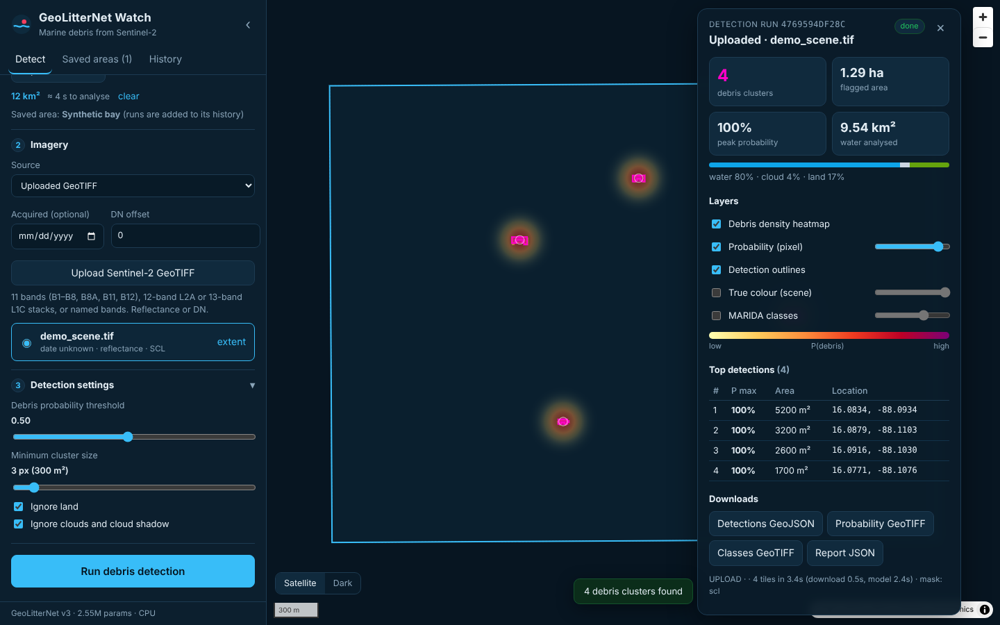

# GeoLitterNet Watch

**Marine-debris heatmaps from Sentinel-2, powered by the GeoLitterNet segmentation model.**

Draw an area over the sea, pick a date range, and the app fetches the least-cloudy Sentinel-2 L2A pass,
runs GeoLitterNet on every 10 m pixel, masks land and cloud, and shows a debris-probability heatmap,
outlined debris clusters with coordinates, and downloadable GeoTIFF/GeoJSON products.


<sub>Screenshot from the built-in synthetic test scene. Real runs show the satellite basemap underneath.</sub>

| | |
|---|---|
| **Imagery** | Sentinel-2 L2A from **STAC / AWS Earth Search** (default, free, no account), **Google Earth Engine** (optional, your credentials), or an **uploaded GeoTIFF** (offline) |
| **Model** | GeoLitterNet v3, 2.55 M parameters, 15 MARIDA classes, checkpoint `geolitternet_v3_seed42.pth` (Marine Debris = class 0) |
| **Outputs** | density heatmap, pixel probability map, MARIDA class map, true colour, detection polygons, `probability.tif`, `classes.tif`, `detections.geojson`, `report.json` |
| **Workflow** | on-demand runs, saved areas with *Run latest*, full run history |
| **Runs on** | your PC, CPU only (≈ 0.3 s per 2.5 × 2.5 km tile; a 10 × 10 km area takes ~10–20 s of model time plus download) |

---

## 1. Quick start on Windows (no Docker)

Requirements: **Python 3.10 – 3.13** (3.12 recommended, from python.org, with *Add python.exe to PATH* ticked) and an internet connection.

1. Double-click **`Setup.bat`** (one time, ~5 min). It creates `backend\.venv`, installs CPU PyTorch and the
   dependencies, copies `.env.example` to `.env`, and runs a self-check.
2. Double-click **`Start.bat`**. Your browser opens **http://localhost:8000**.

Or from PowerShell in the project folder:

```powershell
.\scripts\setup.ps1          # once
.\scripts\run.ps1            # start (add -Lan to allow other PCs on your network, -Port 8080 to change port)
.\scripts\selfcheck.ps1 -Live   # optional: download a real scene and run the model end to end
.\scripts\test.ps1           # optional: run the 24-test suite
```

The web UI is pre-built in `frontend\dist`, so Node.js is **not** needed unless you change the UI.

## 2. Quick start with Docker

```powershell
copy .env.example .env      # optional settings
docker compose up -d --build
# open http://localhost:8000      logs: docker compose logs -f      stop: docker compose down
```

One container serves the API, the model and the UI. Data persists in `.\data`; secrets are read from `.\secrets`.

## 3. Using the app

1. **Detect → Area of interest**: *Draw rectangle* (click-drag), *Use map view*, or *Import GeoJSON*. Limit: 400 km² per run (configurable).
   Name it and click **Save** to make it a saved area.
2. **Imagery**: choose the source and dates. *Find scenes* lists every Sentinel-2 pass with cloud % and AOI coverage;
   keep **Best available scene** to let the server choose (covers the area → least cloud → most recent).
3. **Detection settings** (optional): probability threshold (default 0.5), minimum cluster size, land/cloud masking.
4. **Run debris detection**. Progress is shown live. When the run finishes:
   - **Debris density heatmap**: zoom-adaptive glow, so small clusters stay visible at regional zoom.
   - **Probability (pixel)**: the model's per-pixel P(Marine Debris), 10 m.
   - **Detection outlines**: connected clusters above the threshold; click one for probability, area and coordinates.
   - **True colour / MARIDA classes** for context (Sargassum, foam, ships, wakes and other look-alikes).
   - **Top detections** table (click to zoom) and **downloads**.
5. **Saved areas → Run latest** re-analyses an area on the best scene of the last N days. **History** keeps every run.

## 4. Configuration

All settings are environment variables (prefix `GLN_`) and can be placed in `.env`. See [`.env.example`](.env.example).

| Variable | Default | Meaning |
|---|---|---|
| `GLN_DEFAULT_PROVIDER` | `stac` | `stac`, `gee` or `upload` |
| `GLN_STAC_URL` / `GLN_STAC_COLLECTION` | Earth Search v1 / `sentinel-2-l2a` | any STAC API serving S2 L2A COGs |
| `GLN_GEE_ENABLED`, `GLN_GEE_PROJECT`, `GLN_GEE_SERVICE_ACCOUNT`, `GLN_GEE_KEY_FILE` | off | Earth Engine; see [docs/GEE_SETUP.md](docs/GEE_SETUP.md) |
| `GLN_DEBRIS_THRESHOLD` | `0.5` | default P(debris) threshold for clusters |
| `GLN_MIN_CLUSTER_PIXELS` | `3` | smallest reported cluster (3 px = 300 m²) |
| `GLN_MASK_LAND` / `GLN_MASK_CLOUDS` | `true` | analyse open water only |
| `GLN_MAX_AOI_KM2` | `400` | area limit per run |
| `GLN_DEVICE` | `cpu` | `cuda` if you later add an NVIDIA GPU (install the CUDA PyTorch build) |
| `GLN_TORCH_THREADS`, `GLN_BATCH_SIZE`, `GLN_TILE_OVERLAP` | `0`, `4`, `64` | performance tuning |
| `GLN_API_KEY` | empty | if set, every API call needs `X-API-Key` (the UI asks once) |
| `GLN_DATA_DIR` | `backend/data` | SQLite DB, run products, uploads |

## 5. Project layout

```
backend/
  app/ml/            architecture.py (verbatim from training), preprocess.py (training-identical inputs), engine.py (tiled inference)
  app/imagery/       stac.py, gee.py, upload.py (providers), masks.py (SCL/spectral water-cloud-land masks), geo.py
  app/pipeline/      runner.py (scene → pixels → model → masks → products), outputs.py (PNG/GeoTIFF/GeoJSON)
  app/api/routes.py  REST API        app/jobs.py  background queue        app/db.py  SQLite models
  app/selfcheck.py   diagnostics     models/geolitternet_v3_seed42.pth    tests/  (24 tests)
frontend/            React + TypeScript + MapLibre (dist/ = pre-built UI)
docs/                ARCHITECTURE.md, MODEL_NOTES.md, GEE_SETUP.md, API.md
scripts/             setup / run / test / selfcheck / build-ui (PowerShell + bash)
Dockerfile, docker-compose.yml, .env.example
```

## 6. API

Interactive docs at **http://localhost:8000/docs**. Summary in [docs/API.md](docs/API.md). Typical automation:

```bash
curl -X POST localhost:8000/api/runs -H "Content-Type: application/json" -d '{
  "geometry": {"type":"Polygon","coordinates":[[[-88.10,16.05],[-88.02,16.05],[-88.02,16.12],[-88.10,16.12],[-88.10,16.05]]]},
  "start_date": "2026-09-01", "end_date": "2026-10-31", "max_cloud": 30 }'
# -> {"id": "...", "status": "queued"}  then poll GET /api/runs/{id}
```

## 7. Read before trusting a detection

GeoLitterNet flags *pixels that look like MARIDA "Marine Debris"*: floating aggregations large enough to
affect a 10 m pixel. It does not prove the material is plastic. See [docs/MODEL_NOTES.md](docs/MODEL_NOTES.md)
for the validated accuracy, the training-input scaling the app reproduces, the ACOLITE-vs-Sen2Cor domain gap,
and recommended threshold calibration.

## 8. Troubleshooting

| Symptom | Fix |
|---|---|
| Self-check: `stac FAIL cannot reach STAC API` | A firewall or proxy blocks `earth-search.aws.element84.com` / `sentinel-cogs.s3.us-west-2.amazonaws.com`. Allow them, switch to GEE, or use uploads. |
| "No Sentinel-2 scene ..." | Widen the dates or raise *Max scene cloud cover*. Sentinel-2 revisits every ~5 days. |
| Area rejected | Draw ≤ 400 km² or raise `GLN_MAX_AOI_KM2` (memory ≈ 100 MB per 100 km²). |
| "No usable open-water pixels" | The area is land, cloud or outside the scene; move it offshore or pick another date. |
| `pip` fails on rasterio | Use Python 3.10–3.13 (wheels include GDAL); do not use 3.14 yet. |
| Port 8000 busy | `.\scripts\run.ps1 -Port 8080` |
