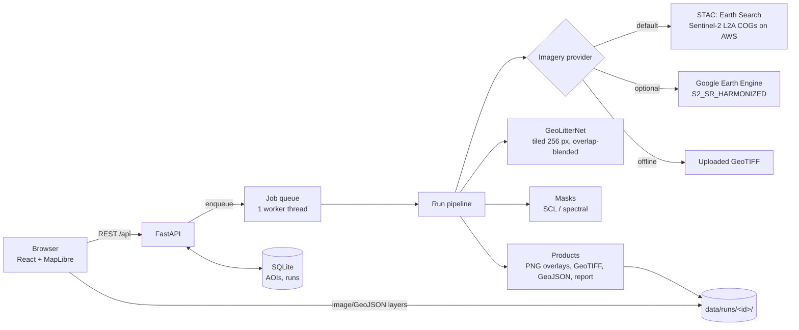

# Architecture

## Request lifecycle

1. **POST /api/runs** validates the polygon (GeoJSON, ≤ `GLN_MAX_AOI_KM2`), stores a `queued` run and hands its id to
   the queue (HTTP 202).
2. The worker runs `pipeline.runner.execute`:
   * **searching**: if no scene was chosen, search the date range and pick: covers ≥ 50 % of the area → lowest
     (cloud % + uncovered %) → most recent. A scene is one satellite pass; MGRS granules of that pass are mosaicked.
   * **fetching**: build a 10 m grid in the local UTM zone snapped to the AOI; read only the needed COG blocks of the
     11 bands + SCL (20/60 m bands resampled bilinearly, SCL nearest); convert DN → reflectance using STAC
     `raster:bands` scale/offset (handles processing baseline ≥ 04.00).
   * **inferring**: training-identical 16-channel stack, 256 px tiles with 64 px overlap and cosine blending, softmax.
   * **rendering**: masks (cloud, land, no-data, AOI), connected-component clusters ≥ threshold, products.
3. The UI polls **GET /api/runs/{id}** (progress 0–1 and a status message) and, when done, loads the PNG overlays
   (warped to Web Mercator, so MapLibre places them exactly) and `detections.geojson`.

## Key decisions

| Decision | Why |
|---|---|
| STAC (Earth Search) as default, GEE as a switchable adapter, plus uploads | STAC needs no account and reads COG windows directly. GEE is available when credentials exist. Uploads cover offline use and testing. All three share one `ImageryProvider` interface. |
| One process, one worker, SQLite | CPU inference is serial anyway (model lock). Restart-safe: queued runs are recovered and interrupted ones marked failed. No Redis or Postgres to install on Windows. |
| Architecture copied verbatim; preprocessing reproduced bit-for-bit | The checkpoint loads with `strict=True`, and parity tests catch drift. See MODEL_NOTES.md (input scaling). |
| UTM 10 m analysis grid, Web Mercator overlays | Model at native resolution; overlays align exactly with web basemaps. |
| Density heatmap (client) + pixel probability (server) | Pixel maps vanish at regional zoom; the client heatmap of cluster centroids keeps hotspots visible at any zoom. |
| UI served by FastAPI (`frontend/dist`) | One URL, one process, no Node at runtime; Docker uses the same layout. |

## Scaling path

* **GPU**: `GLN_DEVICE=cuda` with the CUDA PyTorch build. Larger `GLN_BATCH_SIZE`.
* **Multi-user server**: put Caddy or Nginx in front for HTTPS, set `GLN_API_KEY` (or add SSO at the proxy), and back up `data/`.
* **Horizontal**: move the queue to Redis + RQ/Celery workers, the database to Postgres/PostGIS, and products to
  object storage; the runner and providers are already stateless functions of (run id, settings).
* **Scheduled monitoring** (not in v1 by choice): a cron/Task Scheduler call to `POST /api/aois/{id}/runs` per saved area
  gives periodic checks today; alerting can be built on `stats.clusters` / `max_prob` in the run result.
